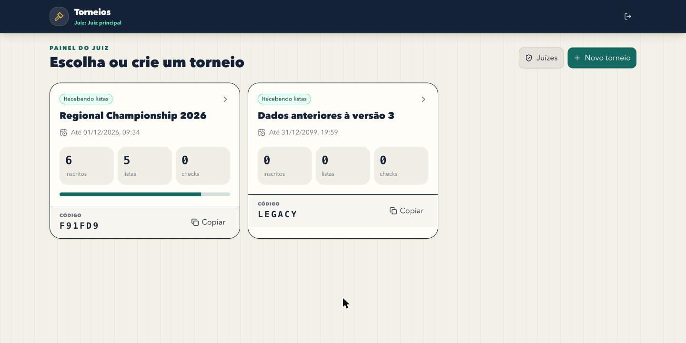
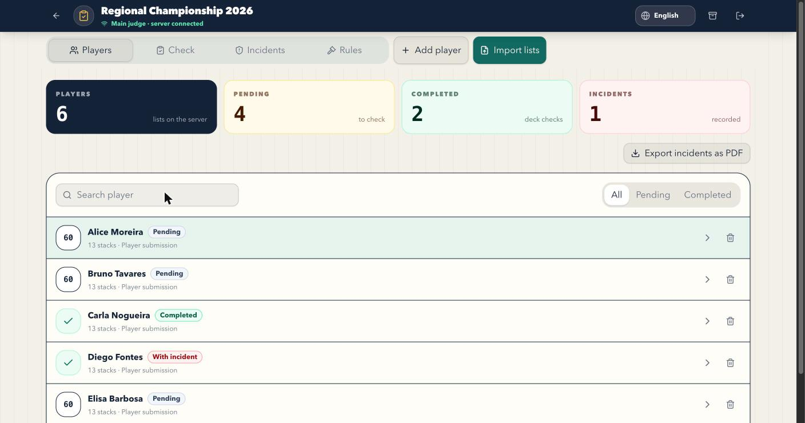
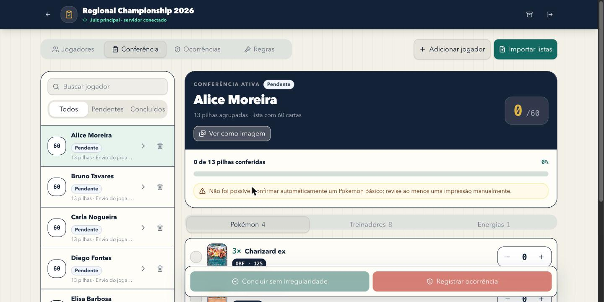
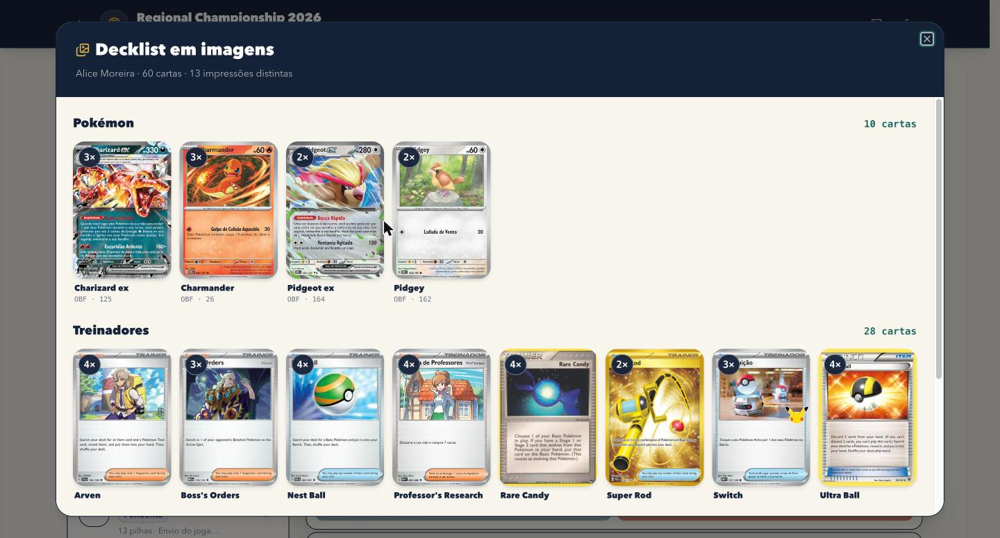
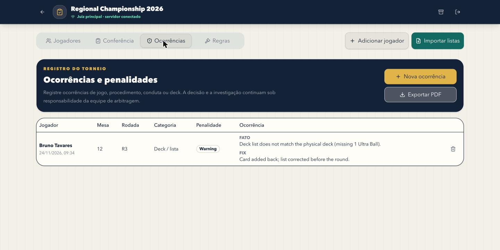
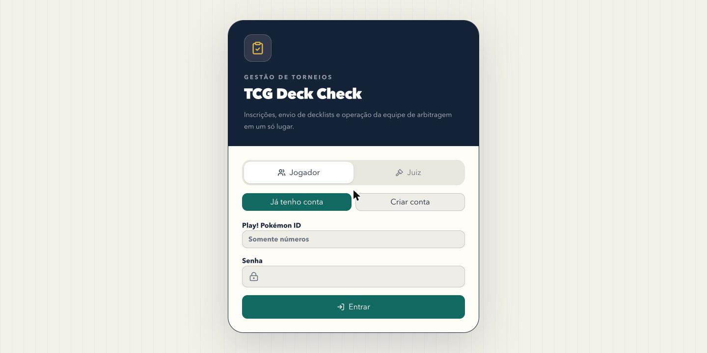

# 🃏 TCG Tournament Check

**Tournament operations platform for Pokémon TCG judges and organizers**, built for and used at real competitive events. Players submit decklists online, judges run deck checks, log penalties and export reports, all from one self-hosted installation reachable from phones, iPads and desktops.

> Documentation in Portuguese lives in [`docs/OPERATIONS.md`](docs/OPERATIONS.md) (install, tunnel, update, backup).

## Screenshots

Demo data only (fictional players).

| Judge dashboard | Players and decklists |
|---|---|
|  |  |
| **Deck check** | **Decklist as images** |
|  |  |
| **Occurrences and penalties** | **Sign-in** |
|  |  |

## Why it exists

Deck checks at Pokémon TCG events usually mean paper lists, PDFs from RK9, WhatsApp screenshots and notes scattered across judges. This project centralizes the whole flow: collecting lists before the event, validating them, tracking the physical check on the day, and producing penalty reports afterwards.

## Features

**Players**
- Account per player (name, Play! Pokémon ID, password) and tournament sign-up by short code
- Decklist editor: search by name, tap the card image to add copies, or paste the **Pokémon TCG Live** export
- Live validation: 60 cards, Pokémon / Trainer / Energy counts, 4-copy rule (basic Energy exempt), at least one Basic Pokémon
- Server-enforced deadline; the list is locked after submission

**Judges**
- One account per judge, isolated data per tournament
- Batch import from **PDF (RK9), image, TXT or WhatsApp text**, with local OCR for scanned forms
- Deck-check progress, physical card count and completion tracking
- Occurrence log (Table, Player, Fact, Penalty, Fix) tied to the judge's session
- **PDF export** of deck-check occurrences and penalties, per tournament
- Quick reference for deck-check and game rules; responsive UI for phone, iPad and desktop

**Card data**
- One catalog module backed by TCGdex: exact printing lookup by set code and collector number, category-aware name search, Portuguese and English artwork (Limitless CDN only as a last resort)
- Basic Pokémon verified from the catalog; manual review requested when it can't be confirmed

> OCR and automatic card matching must be reviewed. The tool supports the judge team; it does not replace investigation or the Head Judge's decision.

## Architecture

```
 browser / Mobile ──► nginx ──► Next.js (vinext) frontend
                       └────► Node API (Express) ──► SQLite (node:sqlite)
                                   ├─ TCGdex (card catalog)
                                   ├─ poppler + Tesseract (PDF/OCR)
                                   └─ pdfkit (reports)
```

- Docker Compose with three containers (proxy, frontend, API); the database lives in a named volume
- Optional public access through an ngrok tunnel with a fixed domain
- GitHub Actions: build, tests and lint on every push to `main` and on every PR
- Automatic, content-preserving migrations between versions (v2 → v3)

## Tech stack

`TypeScript` · `Next.js 16` · `React 19` · `Tailwind CSS` · `Node.js 22` · `Express` · `SQLite` · `Drizzle` · `PDFKit` · `Tesseract OCR` · `Docker` · `Nginx` · `GitHub Actions`

## Project structure

```
server/            Express API
  auth/            passwords, sessions, login throttling, role guards
  routes/          one router per resource (auth, tournaments, players, penalties…)
  catalog/         TCGdex client, set-code registry, card search and resolution
  decks/           decklist parser, text/PDF/OCR extraction, Basic Pokémon validation
  reports/         PDF generation
  store/           SQLite persistence
features/          React code, one folder per area
  tournaments/     sign-in, dashboards, player deck builder
  judge-workspace/ player list, deck check, penalties, import, rules
  cards/           card artwork and the decklist image view
components/ui/     shared UI primitives (shadcn)
app/  lib/  tests/ Next.js entry, client helpers, test suites
```

## Quick start

Requirements: Docker with Compose, and `openssl`.

```bash
git clone https://github.com/SamuelNahas/tcg-deck-check.git
cd tcg-deck-check
./scripts/start-deckcheck.sh        # Windows: scripts\start-deckcheck.ps1
```

Open <http://localhost:8080> and sign in as `admin` with the `DECKCHECK_APP_PASSWORD` value from `.env` (generated from [`.env.example`](.env.example)).

## Development

```bash
npm ci
DECKCHECK_APP_PASSWORD='test-password' DECKCHECK_DB_PATH='./data/deckcheck.sqlite' npm run api
npm run dev          # in another terminal
npm test && npm run lint
```

## Rules reference

Built around the official Play! Pokémon documents: [Tournament Rules Handbook](https://www.pokemon.com/static-assets/content-assets/cms2/pdf/play-pokemon/rules/play-pokemon-tournament-rules-handbook-en.pdf), [TCG Tournament Handbook](https://www.pokemon.com/static-assets/content-assets/cms2/pdf/play-pokemon/rules/play-pokemon-tcg-tournament-handbook-en.pdf) and [Penalty Guidelines](https://www.pokemon.com/static-assets/content-assets/cms2/pdf/play-pokemon/rules/play-pokemon-penalty-guidelines-en.pdf). The current official document always prevails.

*Not affiliated with or endorsed by Nintendo, Creatures, GAME FREAK or The Pokémon Company International. Pokémon and card images are trademarks of their respective owners.*
